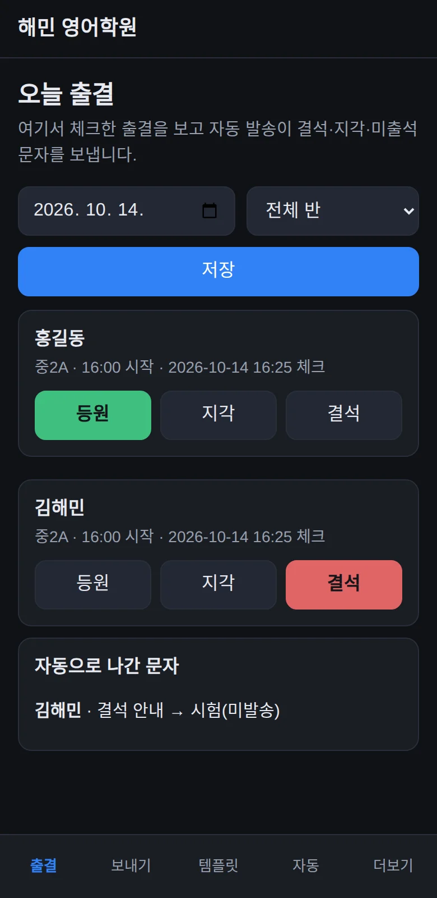
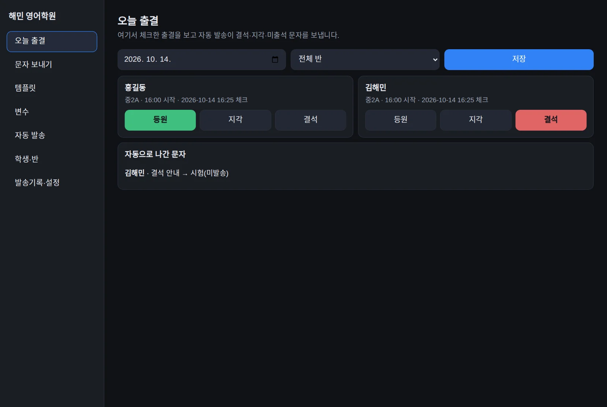
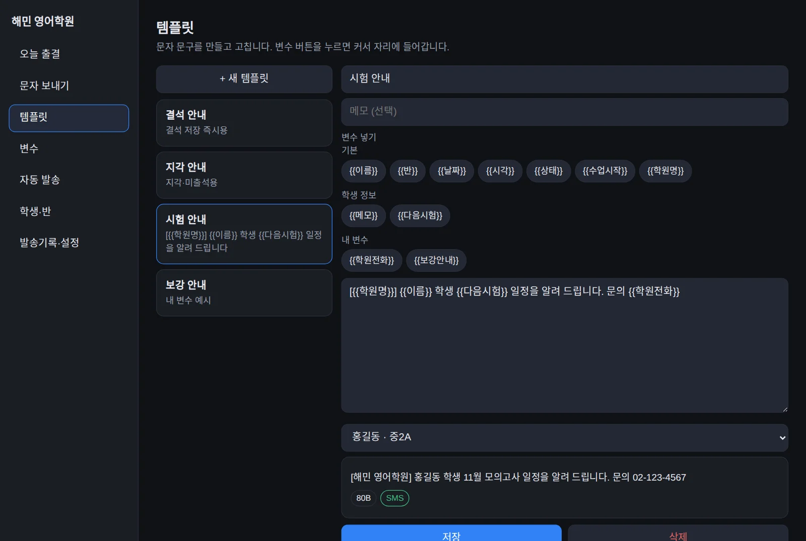
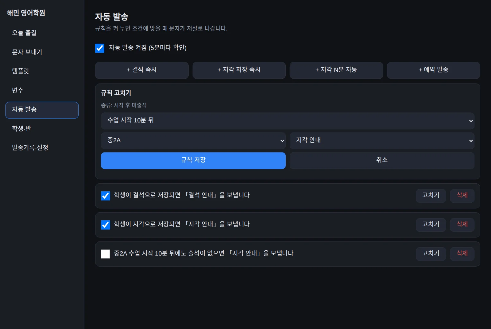

# 학원 출결·학부모 문자 앱

구글 시트 + Apps Script로 만든 학원 출결·학부모 문자 앱입니다. 무료로 쓰고 고칠 수 있는 MIT 라이선스로 나눕니다.

## 무엇을 하나요?

- **메뉴 7개**: 오늘 출결, 문자 보내기, 템플릿, 변수, 자동 발송, 학생·반, 발송기록·설정
- **자동 발송 4종**: 결석 저장 즉시, 지각 저장 즉시, 시작 후 미출석, 예약 발송
- **시험 모드**: Solapi 연결 전에는 문자를 보내지 않고 `시험(미발송)`으로 기록합니다.
- **실제 발송**: Solapi를 연결하면 문자를 보냅니다. SMS 건당 18원·LMS 건당 45원이며 부가세는 별도입니다. 2026년 공개 가격으로, 바뀔 수 있습니다.

## 화면을 둘러보세요

아래 화면은 모두 예시 자료이며 전화번호는 가짜 번호입니다.









## 설치하기

처음이라면 [설치 안내](설치.md)를 순서대로 따라 해 보세요. 시트의 열 구성은 [시트 구성 안내](sheet-template.md)에 있습니다.

1. 구글 시트를 만들고, Apps Script에 `Code.gs`·`logic.js`·`Index.html` 파일 3개를 붙여 넣습니다.
2. 시트 메뉴에서 **학원 문자 → 시트 준비(처음 한 번)**을 실행합니다.
3. Apps Script에서 **웹 앱으로 배포**한 뒤 나온 주소를 엽니다.

### 어렵다면 AI에게 맡기기

Codex나 Claude Code를 쓰신다면 이 저장소 주소와 [블로그 안내](https://haeminway.com/ko/diy/academy-sms-app/)를 주고 "내 구글 계정에 세팅해 줘"라고 하세요. `clasp`로 새 시트와 Apps Script 프로젝트를 만들고 코드를 올릴 수 있습니다(`appsscript.json` 포함). 구글 로그인·권한 허용은 직접 누르고, Solapi 키는 직접 넣으세요. 처음이면 [Apps Script 설정](https://script.google.com/home/usersettings)에서 Apps Script API를 켜야 합니다.

## 설치 전에 미리보기

이 폴더에서 아래 명령을 실행하세요.

```bash
python3 -m http.server
```

브라우저에서 [미리보기 화면](http://localhost:8000/preview.html)을 여세요. `preview.html`은 예시 자료로 동작하며 실제 문자는 보내지 않습니다.

## 테스트

Node.js가 설치되어 있다면 이 폴더에서 실행할 수 있습니다.

```bash
node --test logic.test.js
```

## 사용 전 확인해 주세요

- 학생 이름·학부모 번호·문자 내용이 구글 시트에 남습니다. 시트의 공유 범위와 학부모의 문자 수신 동의를 확인해 주세요.
- 첫 실제 발송은 **내 번호로 1건** 보내 도착을 확인해 주세요.

자세한 설명은 [블로그 안내](https://haeminway.com/ko/diy/academy-sms-app/)에서 볼 수 있습니다.

## 라이선스와 문의

[MIT 라이선스](LICENSE) — 개인·학원 사용, 수정, 재배포가 자유롭습니다.

문의는 [연락 페이지](https://haeminway.com/ko/contact)로 남겨 주세요.
